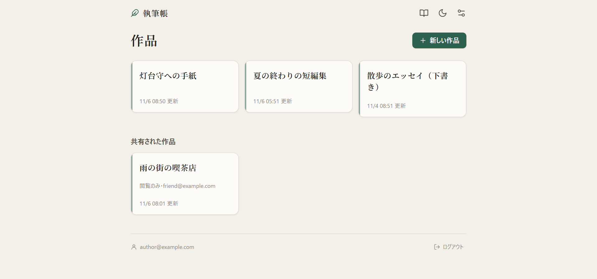
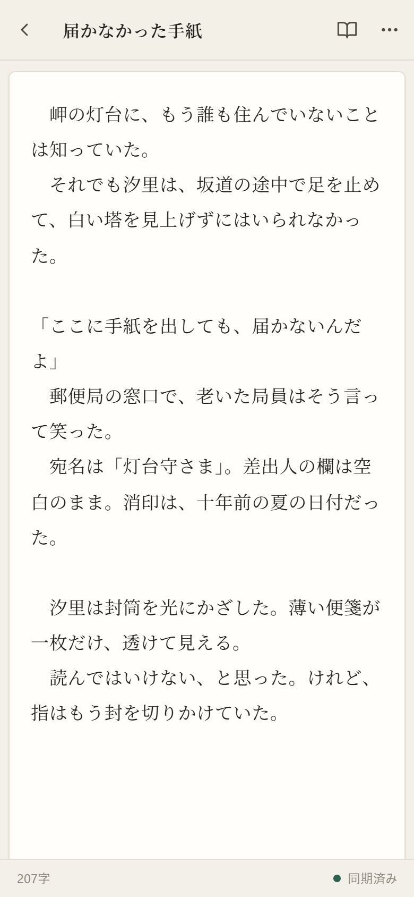
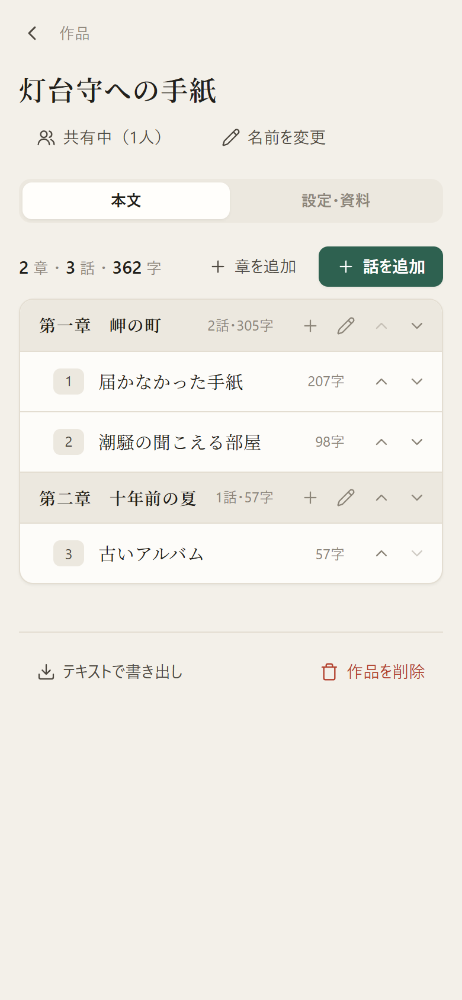
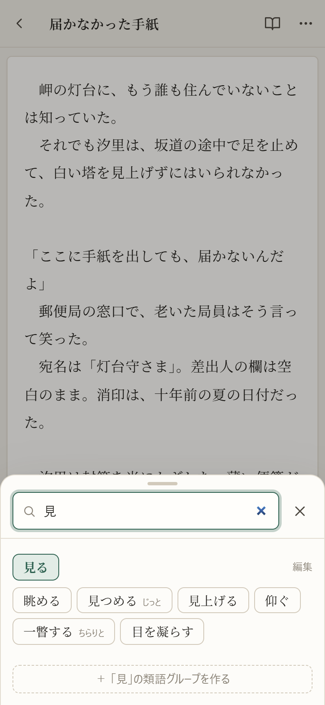
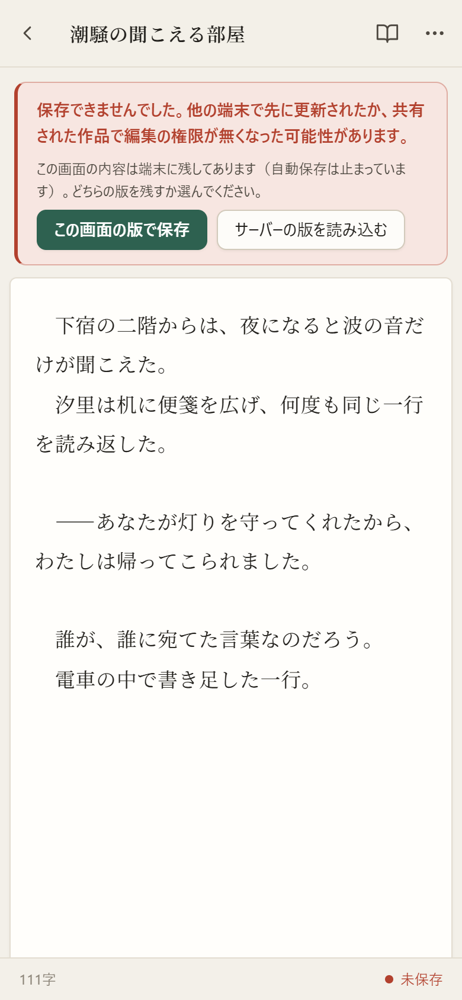
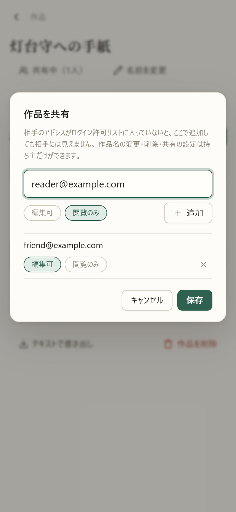
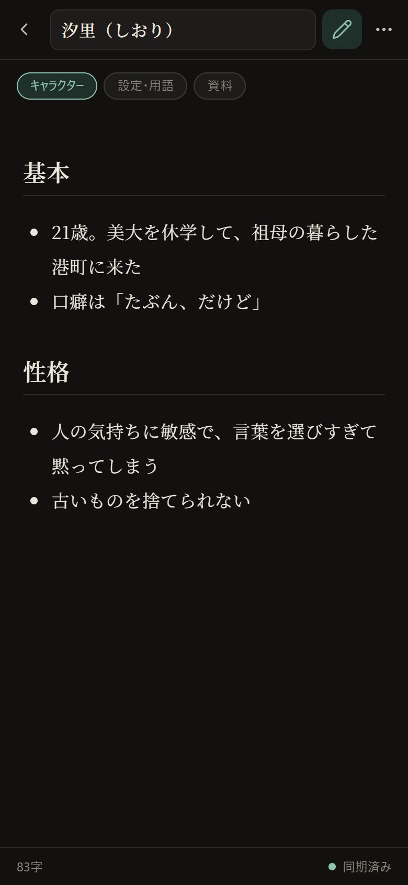

# shosai（執筆帳）

スマホと PC のどちらからでも書ける、個人向けの執筆 PWA。小説を中心に、文章を書くこと全般に使える。React + TypeScript + CodeMirror 6 + Firebase。

- Repository: https://github.com/nishigawa-naoki/shosai
- Production: https://shosai-app.web.app
  - ログインできるのは許可リストに登録した Google アカウントだけ。それ以外のアカウントでは「利用できません」と表示される

自分が日常的に使う道具として作り、実際にスマホと PC を行き来しながら執筆に使っている。
「余計な入力補助をしない、書くことに集中できるエディタ」と「どの端末からでも、オフラインでも書けて、原稿を失わない同期」を目指した。

## スクリーンショット



| 執筆画面 | 章立て | 類語帳 |
| :---: | :---: | :---: |
|  |  |  |
| **編集の衝突の検出** | **作品の共有** | **設定メモ（Markdown・ダーク）** |
|  |  |  |

- **編集の衝突の検出**：もう1台の端末がオフライン中に書いた内容が、先に保存された版とぶつかってサーバーに拒否されたところ。画面の内容は残したまま、どちらの版を残すかを選べる
- 画像はすべて Firebase エミュレーター上のデモデータ（架空のアカウントと文章）で、`node e2e/screenshots.cjs` で撮り直せる

## アピールポイント

### 1. オフラインでも書けて、複数の端末で編集しても原稿を失わない同期

- Firestore のオフラインキャッシュ（IndexedDB）で、電波のない場所でも読み書きできる。オンラインに戻ると自動で同期する
- **編集の衝突を検出する**：保存のたびに「この編集の元にした版」を一緒に送り、サーバー上の最新版と一致しない書き込みは
  **Firestore ルールで拒否する**。他の端末の更新を知らない古い画面やオフライン中にたまった書き込みが、新しい原稿を黙って上書きすることはない
- 拒否されたときは画面の内容を残したまま、「この画面の版で保存／サーバーの版を読み込む」を利用者に選ばせる
- 送信が確定するまでの内容は localStorage に退避している。アプリを閉じた後に拒否されても、次に開いたときに復元して確認を求める
- 同じ話を2台で開いていると、一方の保存がもう一方の画面にカーソル位置を保ったまま反映される（未保存の入力がない場合）

### 2. サーバー側のルールで守る認可（ログイン許可リスト・作品ごとの共有）

- アカウントごとにデータを分け、作品単位で他のアカウントに **「編集可」「閲覧のみ」** の権限で共有できる
- 権限は画面でボタンを隠すだけでなく、**すべて Firestore セキュリティルールで強制している**。
  閲覧のみの相手の書き込み、編集可の相手による作品名・共有設定の変更、共有されていない人の読み取りは、サーバーが拒否する
- 共有された作品の一覧は collection group の問い合わせで取得し、ルール上も「自分のアドレスを含む作品」に限っている
- 編集中に共有を解除・降格されたときも、保存できなかった入力を画面で案内し、コピーして控えられるようにした

### 3. 料金と速さを意識したデータ設計・段階的な移行

- 一覧用の小さな文書（タイトル・文字数・並び順）と本文の文書を分けた。一覧の画面は本文を読み込まないので、長編でも軽い
- 一覧用の情報の書き込みは間引き（タイトルが変わったとき・一定時間ごと・画面を離れるとき）、Firestore の書き込み回数を抑えている
- 旧形式のデータ（本文を一覧用の文書に持っていた）は、作品を開いたときにトランザクションで新形式へ移す。
  移行中に旧版のアプリが本文を書いても、どちらの内容も捨てない
- PWA は各端末で旧版がしばらく動き続ける。そのため、ルールやデータの形を変えるときは、**旧版のアプリでも壊れない順序・形** にしている

### 4. PWA としての作り込み

- 新しい版は自動で切り替えず、「新しいバージョンがあります［更新］」で利用者が切り替える。
  更新直後に画面が真っ白になる不具合が起きたことを受けて、この方式に変えた
- 画面ごとにコードを分割して読み込む。更新で古いファイルが消えて読み込みに失敗したときは、1回だけ自動で再読み込みして復帰する
- CodeMirror・Markdown の描画など重い部分は、使う画面を開いたときに初めて読み込む

### 5. 執筆に集中するためのエディタ

- CodeMirror 6 を、括弧の自動補完・自動インデント・入力補完・スペルチェックを外した最小構成で使っている。日本語 IME の変換中の入力も考慮した
- 小説向けの自動修正（段落頭の字下げ、三点リーダー「……」・ダッシュ「――」への変換、！？の後の空白など7項目）は **項目ごとに選べる任意機能** で、既定はすべて無効。
  修正は Ctrl+Z で修正だけを取り消せる
- Markdown モード（記法の色付けとプレビュー）。プレビューは DOMPurify で無害化してから表示する
- 章立て、キャラクター・設定・資料のメモ、作品をまたいで使える類語帳、文字数（空白・改行を除く）、テキストでの書き出し、ライト／ダークテーマ

### 6. エミュレーターを使った E2E テスト

Firebase エミュレーター上で、本番と同じルールを使い、Playwright でブラウザを自動操作して確認している（`e2e/`）。

| スクリプト | 確認していること |
| --- | --- |
| `sync.cjs` | 2台の端末での同期、古い画面・オフライン中の書き込みによる上書きの防止と解決、保存失敗時に入力が残ること |
| `share.cjs` | 共有の画面と権限、ルールでの拒否（REST で直接書き込んで確認）、編集中の共有解除 |
| `chapters.cjs` | 章の追加・変更・削除・並べ替え、章ごとの集計、書き出し |
| `migration.cjs` | 旧形式データの移行 |
| `autocorrect.cjs` | 自動修正の各項目、取り消し、ダイアログ |
| `smoke.cjs` | 公開サイトの簡易確認 |

## 開発体制

本プロジェクトは [Claude Code](https://www.anthropic.com/claude-code) を用いた AI 駆動開発で構築している。

- 自分が利用者として使い、気になった点・欲しい機能を要望として出し、仕様を決めて実装させる
- 実装の区切りごとに、**先入観のないサブエージェントにレビューさせる**（`.claude/skills/milestone-review`）
  - 観点は「セキュリティ」「動作・バグ」「冗長な処理」。実装の意図は伝えず、差分と観点だけを渡す
  - 指摘はそのまま採用せず、1件ずつコードを読み、再現して「確定（修正）／却下（理由を記録）／要相談」に分ける
  - レビュー済みの位置を `last-review` タグで記録し、次は差分だけをレビューする
- 機能を足すたびに E2E テストを追加し、既存のテストもすべて通してからデプロイする
- 本番へのデプロイは、毎回自分が確認してから行う

## 技術スタック

React 19 / TypeScript / Vite / CodeMirror 6 / Firebase（Authentication・Firestore・Hosting）/ vite-plugin-pwa / marked + DOMPurify / Playwright（E2E）/ oxlint

## 構成

```
src/
  App.tsx                      ルーティング（自分の作品 /works/... と共有された作品 /shared/...）
  components/Editor.tsx        CodeMirror のラッパー（入力まわりの挙動）
  components/EditorScreen.tsx  本文・メモ共通の編集画面
  components/ShareDialog.tsx   共有の設定
  lib/db.ts                    データ構造と Firestore の読み書き
  lib/useAutosave.ts           自動保存・他の端末の更新の取り込み・衝突の検出
  lib/workScope.tsx            作品の持ち主と自分の権限
  pages/                       各画面
firestore.rules                認可（許可リスト・共有・版の確認）のひな形
scripts/build-rules.cjs        ひな形に許可リストを入れて、使うルールを作る
e2e/                           E2E テスト
```

データ構造：

```
users/{uid}/works/{workId}            作品（sharedWith・editors で共有）
  episodes/{id}                       話・章の見出しの一覧用の情報（章は kind: 'chapter'）
  episodeBodies/{id}                  話の本文
  notes/{id} ・ noteBodies/{id}       設定メモ・資料（一覧用・本文）
users/{uid}/thesaurus/{id}            類語帳
users/{uid}/meta/settings             端末間で同期する設定
```

## ログイン許可リスト

ログインを許すアドレスはリポジトリに含めない。

- `allowlist.example.json` をコピーして `allowlist.local.json` を作り、アドレスを書く（先頭は所有者）
- `npm run rules` で、`firestore.rules`（ひな形）に許可リストを入れた `firestore.local.rules` を作る
- デプロイとエミュレーターは `firestore.local.rules` を使う（`firebase.json`）。
  どちらの `.local` ファイルも `.gitignore` 済み

## 開発

```sh
npm install
npm run rules    # 初回と、許可リスト・ルールを変えたとき
npm run dev      # http://localhost:5173
```

### エミュレーターで動かす（本物の Firebase を使わない）

`.env.local` を次の内容にし、`firebase emulators:start --only auth,firestore --project demo-novel` を起動してから
`npm run dev`。ルールは本番と同じ `firestore.local.rules` をそのまま使う。

```
VITE_FIREBASE_API_KEY=fake-key
VITE_FIREBASE_AUTH_DOMAIN=localhost
VITE_FIREBASE_PROJECT_ID=demo-novel
VITE_FIREBASE_APP_ID=1:1:web:1
VITE_USE_EMULATOR=true
```

自動テストからは `window.__emulatorSignIn('<メール>')` でログインできる（開発ビルドかつエミュレーター使用時のみ）。

## ビルド・テスト

```sh
npm run build
npm run lint
node e2e/sync.cjs    # 他のスクリプトも同様。前提は e2e/README.md
```

## デプロイ

```sh
npm run build
firebase deploy --only hosting              # アプリ
firebase deploy --only firestore            # ルール・索引（デプロイ前に npm run rules と同じ処理でルールを作り直す）
```

PWA は各端末で旧版のアプリがしばらく動き続ける。旧版が満たせない条件をルールに足すときは、
アプリを先に公開し、全端末が新版になってからルールを公開する。

アプリは2つのサイトに同じものを公開している（`firebase.json` の `hosting`）。

- `shosai-app`：現在の URL（https://shosai-app.web.app）
- `novel-editor-c94e8`：以前の URL。開くと新しい URL への移動を案内する。
  端末内の未同期の変更は URL ごとに別なので、全端末が移り終えるまではアプリとして使えるまま残す

## 自分の環境に立てる場合

1. [Firebase コンソール](https://console.firebase.google.com/)でプロジェクトを作成し、Authentication の **Google** ログインと Firestore を有効にする
2. ウェブアプリを追加し、表示された設定値を `.env.example` をコピーした `.env.local` に書く
3. `allowlist.local.json` に、ログインを許す Google アカウントのアドレスを書く（先頭を自分にする。上の「ログイン許可リスト」）
4. `firebase use --add` でプロジェクトを選び、`npm run build` してから `firebase deploy`（初回はアプリとルールをまとめて公開してよい）
5. （推奨）Google Cloud コンソールで、API キーの利用元を自分のドメインに制限する

## メモ

- スマホの IME（キーボード）の予測変換は OS の機能のため、アプリからは制御できない
- iOS のホーム画面アイコンは SVG に対応していないため、必要なら `public/apple-touch-icon.png`（180×180）を追加する
